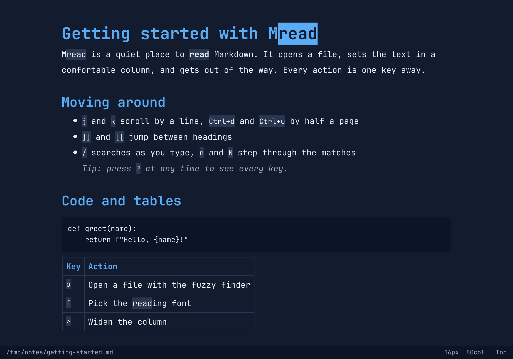

# Mread

A minimal Markdown reader for [Omarchy](https://omarchy.org): vim keys, a fuzzy file finder, and colors that follow the desktop theme.



Mread does one job: it opens a Markdown file and sets it in a comfortable column. It reads files and never edits them.

## Features

- Navigation with vim keys, including counts (`5j`, `3]]`) and heading jumps.
- Search as you type, with every match highlighted.
- A fuzzy finder that lists recent files first, then every Markdown file in your home directory.
- Colors that follow the Omarchy theme and change live when you switch themes.
- A choice of text font, code font, font size and column width, remembered between sessions.
- GitHub-flavored Markdown: tables, task lists, fenced and indented code, block quotes, images.
- Links to other Markdown files and `#heading` anchors open inside Mread; other links open in your browser.
- Automatic reload when the file changes on disk, keeping your place.
- The last file and your place in it are restored when Mread starts.

## Install

Mread is built with Qt 6 and is packaged for Arch Linux, which Omarchy is based on.

```sh
git clone https://github.com/katabex/mread.git
cd mread
bin/install
```

`bin/install` builds the app and installs it with `makepkg -fsi`, which asks for your password. Mread then appears in the app launcher (`Super + Space`).

It needs `qt6-base`, `qt6-declarative`, `qt6-wayland` and `fd` at run time, plus `gcc` and `make` to build. Omarchy ships all of them except possibly `fd`, which `makepkg -s` installs for you.

## Usage

```sh
mread notes.md
```

Without a file, Mread reopens the file you were reading, at the same place. Close a file with `x` to start empty next time; then press `o` to find one. You can also drop a file onto the window.

To make Mread the default app for Markdown files:

```sh
xdg-mime default mread.desktop text/markdown
```

## Keys

Press `?` in the app to see this list.

| Key | Action |
|---|---|
| `j` / `k`, Down / Up | Line down / up |
| `Ctrl+e` / `Ctrl+y` | Line down / up |
| `Ctrl+d` / `Ctrl+u`, `d` / `u` | Half page down / up |
| `Ctrl+f` / `Ctrl+b`, `Space` / `b`, PageDown / PageUp | Page down / up |
| `gg` / `G`, Home / End | Top / bottom |
| `]]` / `[[` | Next / previous heading |
| `/`, then `n` / `N` | Search, then next / previous match |
| `5j`, `3]]` ... | A count before a motion repeats it |
| `o`, `Ctrl+o` | Open a file with the fuzzy finder |
| `x` | Close the file |
| `f` / `F` | Choose the text font / code font |
| `+` / `-` / `0` | Font size up / down / reset |
| `>` / `<` | Column wider / narrower |
| `y`, `Ctrl+c` | Copy the selection |
| `Esc` | Clear the search highlight and selection |
| `?` | Show the keys |
| `q`, `Ctrl+q` | Quit |

Search ignores case unless you type a capital letter, as in vim's `smartcase`, and wraps around at the end of the file. In the finder and font picker, type to filter, move with the arrow keys or `Ctrl+j` / `Ctrl+k`, and press Enter to pick.

## Settings

Fonts, font size, column width and recent files are saved to `~/.config/mread/mread.conf` as you change them, along with the open file and your place in it. The place is the text at the top of the window, so it stays right after you change the font size or column width.

Colors come from the current Omarchy theme (`~/.local/state/omarchy/current/theme/colors.toml`). Without Omarchy, Mread uses a built-in dark palette.

## Development

```sh
bin/build    # qmake6 and make into build/mread
bin/test     # Qt Test suite, run offscreen
```

The code is C++ and Qt Quick in `src/`, built with qmake. Markdown is parsed by Qt's built-in reader, so there are no other dependencies.

## License

MIT, see [LICENSE](LICENSE). The theme watching follows [Omacut](https://github.com/omacom/omacut) (MIT, David Heinemeier Hansson).
